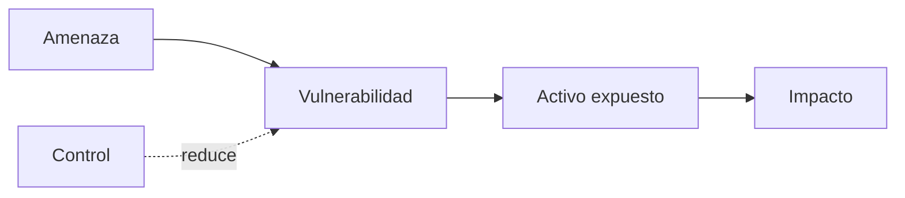
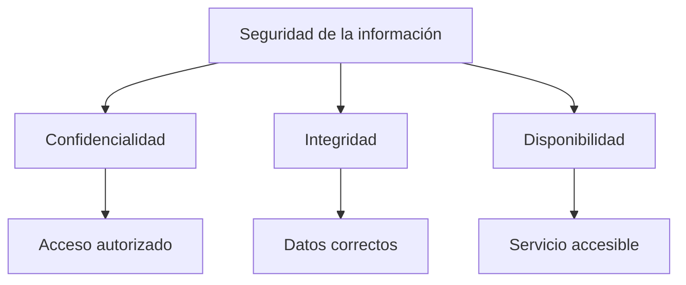

# Fundamentos y tríada CIA

Un programa es un conjunto de instrucciones que cumple una tarea. Que funcione correctamente no significa que sea seguro: también necesita controles, configuración, mantenimiento y usuarios informados. Ningún estándar garantiza ausencia total de vulnerabilidades.

| Concepto | Significado | Ejemplo |
|---|---|---|
| Activo | Recurso valioso | Base de datos |
| Vulnerabilidad | Debilidad susceptible de explotación | Permisos excesivos |
| Amenaza | Evento o acción capaz de causar daño | Acceso no autorizado |
| Riesgo | Posibilidad de pérdida y su impacto | Divulgación de datos |
| Control | Medida para reducir el riesgo | Autorización en servidor |

## Tipos de vulnerabilidad en el apunte
La clasificación es organizacional, no solo informática.

| Tipo | Explicación y ejemplo ilustrativo |
|---|---|
| Ambiental | Exposición del entorno, como inundaciones |
| Física | Ubicación e infraestructura, como sala sin protección |
| Económica | Recursos insuficientes para mantener controles |
| Social | Conductas o relaciones que aumentan exposición |
| Educativa | Falta de capacitación para reconocer riesgos |
| Política | Escasa capacidad para influir en decisiones |
| Institucional | Obstáculos administrativos y respuesta lenta |
| Social relativa a la organización | Coordinación y cooperación insuficientes |

## Tríada CIA

| Pilar | Pregunta | Control de ejemplo |
|---|---|---|
| Confidencialidad | ¿Quién puede leer? | Cifrado y permisos |
| Integridad | ¿Los datos fueron alterados indebidamente? | Validación y control de cambios |
| Disponibilidad | ¿El servicio funciona cuando se necesita? | Respaldo y redundancia |

> [!example] Ejemplo
> Si una aplicación expone datos personales, falla la confidencialidad; si altera registros sin permiso, falla la integridad; si deja de responder, falla la disponibilidad.

Fuente: S5, pp. 8–15.
