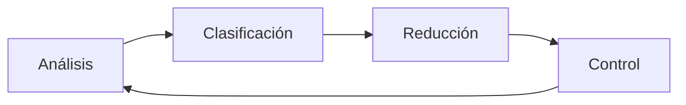

# Gestión de riesgos y SGSI

Gestionar riesgos significa identificar, analizar y tratar la posibilidad de pérdidas sobre personas, datos, aplicaciones e infraestructura. El CISO alinea la seguridad con los objetivos de la organización.

## Cuatro fases del apunte

**Análisis:** identificar activos, amenazas y debilidades. **Clasificación:** decidir qué riesgos son aceptables. **Reducción:** implementar protecciones y capacitar. **Control:** medir eficacia, corregir deficiencias y revisar cumplimiento.

## Matriz de riesgo
El apunte utiliza probabilidad de amenaza × magnitud del daño, ambas de 1 a 4: insignificante, baja, mediana y alta.

| Probabilidad / impacto | 1 | 2 | 3 | 4 |
|---|---:|---:|---:|---:|
| 1 | 1 | 2 | 3 | 4 |
| 2 | 2 | 4 | 6 | 8 |
| 3 | 3 | 6 | 9 | 12 |
| 4 | 4 | 8 | 12 | 16 |

Ejemplo: probabilidad 3 e impacto 4 → 12. Priorizar frente a un riesgo de 2 × 2 = 4, considerando también contexto y controles. Los límites de aceptación deben definirse por la organización.

## Medición OWASP
El objetivo es comparar riesgos con criterios consistentes, considerar probabilidad e impacto y distinguir consecuencias técnicas de consecuencias para el negocio. No confundir una puntuación de vulnerabilidad con una decisión automática de tratamiento.

## SGSI e ISO 27001
Un Sistema de Gestión de Seguridad de la Información organiza personas, procesos y tecnología mediante políticas, responsabilidades, evaluación de riesgos, controles y revisión continua. ISO 27001 orienta su establecimiento y mantenimiento. El inventario identifica activos, responsables y clasificación.

| Activo ficticio | Confidencialidad | Integridad | Disponibilidad |
|---|---|---|---|
| Credenciales | Alta | Alta | Media |
| Catálogo público | Baja | Media | Media |
| Copias de respaldo | Alta | Alta | Alta |

El apunte propone niveles alta, media y baja y una valoración global según las propiedades CIA; los criterios deben quedar definidos sin ambigüedad. La arquitectura de seguridad integra estos requisitos desde el diseño hasta el retiro de la aplicación: permisos, controles, procesos y seguridad por defecto.

Fuente: S5, pp. 16–26. Ejemplos propios.
