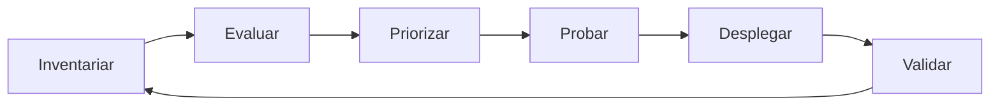

# Hardening y parchado

Hardening es reducir la exposición de un sistema mediante configuraciones seguras, permisos mínimos, servicios necesarios y mantenimiento. Un CVE identifica una vulnerabilidad conocida; no es un parche ni una medida de riesgo por sí mismo.

## Plan de parchado (refuerzo clase 4)

Inventariar versiones y responsables; evaluar gravedad, exposición y uso; priorizar; probar compatibilidad; desplegar con respaldo y recuperación; validar y documentar. El análisis de dependencias ayuda a detectar componentes vulnerables.

| Caso estudiado | Lección |
|---|---|
| EternalBlue / WannaCry, CVE-2017-0144 | Actualizar sistemas y limitar exposición de SMB; un parche sin aplicar no protege. |
| Heartbleed, CVE-2014-0160 | Actualizar OpenSSL afectado, regenerar claves, invalidar credenciales expuestas y monitorear. |

## Comunicaciones y autenticación
TLS protege datos en tránsito; HTTPS emplea TLS para HTTP. MFA exige factores diferentes. SSO centraliza acceso a varios servicios, pero no sustituye la autorización de cada recurso. CAPTCHA limita automatización en puntos de riesgo; debe tener alternativas accesibles. Los tokens necesitan expiración y renovación controlada.

> [!tip] Checklist
> - Inventario y versiones revisados.
> - Servicios innecesarios deshabilitados.
> - Permisos mínimos y MFA cuando corresponda.
> - HTTPS y gestión de sesiones.
> - Parches probados, registros protegidos y alertas atendidas.

Fuente: aprendizaje esperado S5, p. 6; clase 4, secciones CVE, parchado y autenticación. Checklist didáctico propio.
