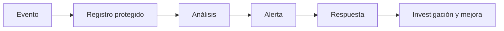

# Registro y monitoreo

El registro (logging) conserva evidencia de lo ocurrido; el monitoreo observa eventos y permite detectar problemas mientras suceden. Sin respuesta, una alerta no reduce por sí sola el riesgo.

## OWASP A09:2021
Anteriormente A10:2017. Los problemas incluyen eventos críticos omitidos, poca información contextual, ausencia de vigilancia activa, alertas desatendidas y registros alterables.



Ejemplo ficticio:
```text
2026-01-01T10:00:00Z login_failed user=demo
2026-01-01T10:00:03Z login_failed user=demo
2026-01-01T10:00:06Z access_denied user=demo resource=admin
```
Los eventos repetidos merecen revisión, pero no prueban por sí solos un ataque.

| Buena práctica | Por qué |
|---|---|
| Registrar fallos de autenticación, autorización y validación | Detectar abuso |
| Registrar cambios de privilegios y operaciones críticas | Trazabilidad |
| Proteger registros contra modificaciones | Investigación confiable |
| Centralizar y alertar | Correlacionar eventos |
| Definir retención según necesidad y normativa | Conservar evidencia sin acumular datos innecesarios |

Como aclaración práctica: nunca registrar contraseñas ni tokens completos. El hash por sí solo no evita manipulación si el atacante también puede reemplazarlo.

Herramientas mencionadas: Splunk, CloudWatch, Azure Monitor y ELK (Elasticsearch, Logstash y Kibana). El apunte menciona GDPR e ISO 27001 en políticas de retención; no establece un plazo universal.

Caso del apunte: una empresa minorista detectó archivos sospechosos pero no respondió; posteriormente se identificaron transacciones fraudulentas. La lección es conectar detección con respuesta y responsables.

Fuente: S5, pp. 29–36.
