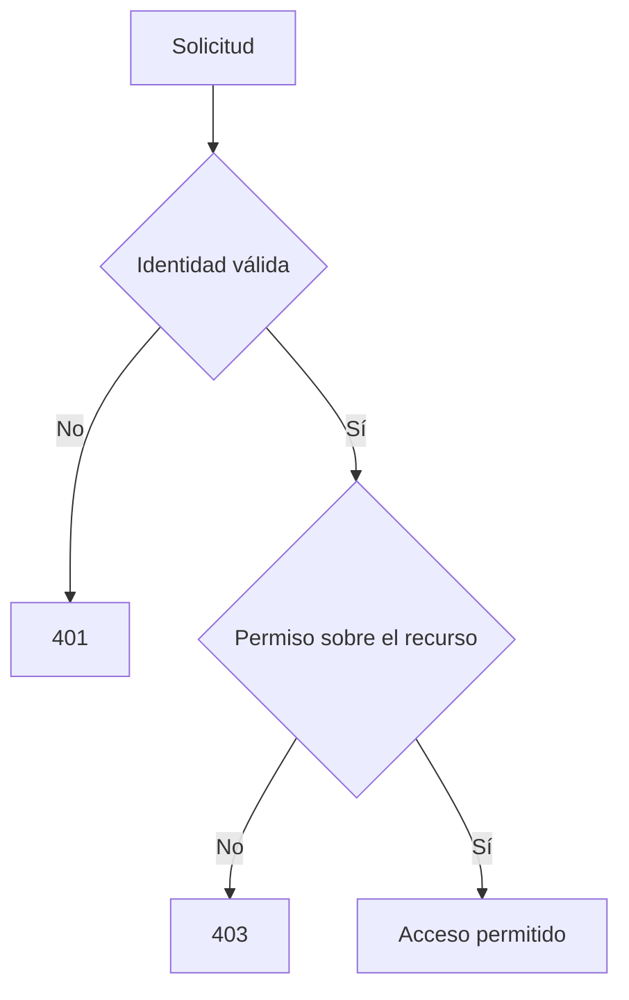

# Control de acceso y autenticación

| Concepto | Pregunta | Ejemplo |
|---|---|---|
| Autenticación | ¿Quién eres? | Contraseña + segundo factor |
| Autorización | ¿Qué puedes hacer? | Consultar solo tus documentos |
| Sesión | ¿Cómo se mantiene tu identidad? | Token con vencimiento |

La pérdida de control de acceso (A01:2021) ocurre cuando el servidor permite operaciones fuera de los permisos establecidos. La autenticación fallida corresponde a otra categoría (A07:2021).



Ejemplo didáctico de autorización:
```python
# Inseguro: devuelve cualquier documento solicitado
return documento
```
```python
# Seguro para este caso simple: identidad obtenida de sesión validada
if documento.propietario_id != usuario.id:
    raise PermissionError("Acceso denegado")
return documento
```
Los permisos se comprueban por operación y recurso, no solamente ocultando botones. Aplicar privilegio mínimo, denegación por defecto, expiración de sesión, cierre efectivo y MFA. Probar con diferentes roles y recursos ficticios.

El caso Facebook de la clase 3 ilustra el riesgo de tokens de acceso comprometidos; reforzar gestión de sesiones y revisión de funcionalidades.

Fuente: S6, pp. 7–10; S7, pp. 11–16; clase 3.
