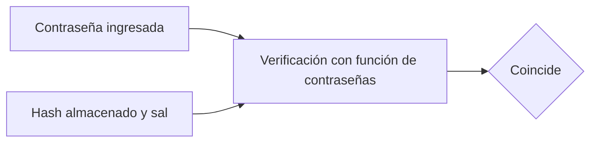

# Criptografía y datos sensibles

A02:2021 (fallos criptográficos) aborda protección insuficiente de datos por ausencia de cifrado, algoritmos débiles o gestión incorrecta de claves.

| Técnica | Finalidad | ¿Reversible? |
|---|---|---|
| Cifrado | Confidencialidad mediante clave | Sí, con clave apropiada |
| Hash | Resumen de datos; verificación | No está diseñado para revertirse |
| Codificación | Representación de datos, como Base64 | Sí, sin secreto |

El cifrado simétrico emplea una clave compartida (ej. AES); el asimétrico usa un par de claves. TLS protege comunicaciones; AES-256 es un ejemplo para cifrado en reposo. Para contraseñas se recomiendan funciones diseñadas para ellas, como Argon2 o bcrypt, con sal y parámetros adecuados; no cifrado reversible ni un hash rápido sin sal.

La gestión de claves incluye protección, acceso restringido, rotación y revocación cuando corresponda. Evitar secretos en código o repositorios públicos. La exposición de información puede tener múltiples causas, no solo fallos criptográficos.

Fuente: S6, pp. 10–11. Comparación de técnicas: ampliación didáctica.
