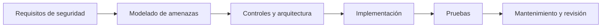

# Diseño seguro

A04:2021 se refiere a controles ausentes o insuficientes desde la arquitectura. No es lo mismo un diseño sin control de autorización que una implementación defectuosa de un control existente.

Ejemplo independiente: un servicio permite operaciones sensibles sin límites ni verificación adicional. Aunque el código cumpla la especificación, la especificación carece de controles. Diseñar límites, autorización y verificaciones proporcionales al riesgo antes de implementar.

El modelado de amenazas identifica activos, fronteras de confianza y amenazas; una revisión comprueba que los controles propuestos sean suficientes. El apunte S7 menciona herramientas OWASP y Microsoft Threat Modeling Tool. ASVS es una referencia de requisitos de verificación (refuerzo clase 3), no una garantía de invulnerabilidad.

Fuente: S6, p. 16; S7, pp. 34–35; clase 3.
