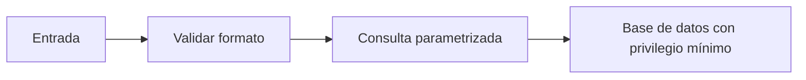

# Inyección y consultas parametrizadas

A03:2021 ocurre cuando datos no confiables son interpretados como instrucciones. Puede afectar confidencialidad, integridad y disponibilidad.

| Variante | Intérprete |
|---|---|
| SQL | Base de datos relacional |
| NoSQL | Motor de consultas no relacional |
| LDAP | Servicio de directorio |
| Sistema operativo | Intérprete de comandos |

## Ejemplo local de SQLite
```python
# Inseguro: mezcla instrucciones y datos
cursor.execute(f"SELECT nombre FROM usuarios WHERE nombre = '{nombre}'")
```
```python
# Seguro frente a inyección en este valor
cursor.execute("SELECT nombre FROM usuarios WHERE nombre = ?", (nombre,))
```
La parametrización separa instrucciones de valores. Validar formato, longitud y tipo según el contexto; no confiar solamente en bloquear caracteres. Un ORM reduce SQL manual, pero no elimina riesgos si se construyen consultas inseguras.



Usar permisos restringidos, revisión de código y pruebas autorizadas. El apunte menciona OWASP ZAP y SQLMap como herramientas de evaluación; practicar únicamente en entornos propios o autorizados. La clase 3 usa TalkTalk como ejemplo de consecuencias de una inyección SQL.

Fuente: S6, pp. 11–16; clase 3.
