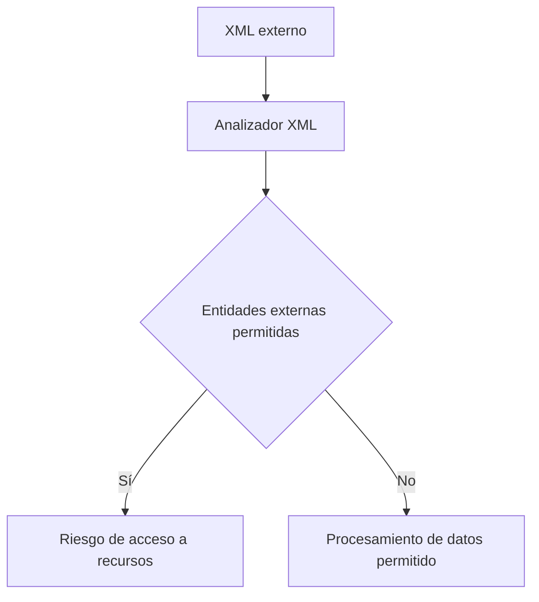

# XML y entidades externas (XXE)

XML representa datos mediante etiquetas definidas para cada documento. Una entidad externa permite referenciar recursos externos en determinados procesadores XML. Si el analizador acepta documentos no confiables y resuelve entidades externas, puede exponer información, realizar solicitudes no previstas o agotar recursos.

```xml
<producto>
  <nombre>Cuaderno</nombre>
  <precio>1500</precio>
</producto>
```



| Medida | Finalidad |
|---|---|
| Deshabilitar DTD y entidades externas cuando no sean necesarias | Evitar resolución no prevista |
| Actualizar bibliotecas | Corregir vulnerabilidades conocidas |
| Limitar tamaño y recursos | Reducir denegación de servicio |
| Validar estructura y esquema cuando corresponda | Rechazar documentos inesperados |
| Restringir acceso a archivos y red | Limitar impacto del procesador |

Como ejemplo defensivo, en Python puede utilizarse un analizador endurecido como `defusedxml` para XML no confiable, según los requisitos del proyecto. La validación de esquema por sí sola no sustituye una configuración segura del parser.

Fuente: S6, pp. 17–24. Nota de clasificación: A4:2017; incorporada en A05:2021, no A04:2021.
