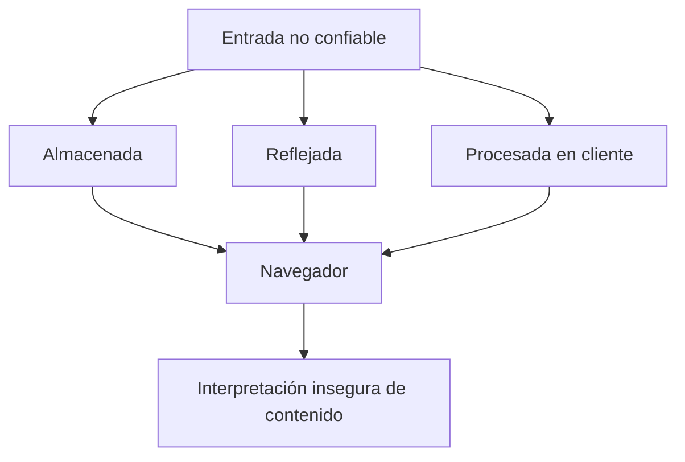

# Cross-Site Scripting (XSS)

XSS permite que contenido no confiable sea interpretado como código por el navegador de otro usuario. Puede comprometer sesiones, alterar páginas y realizar acciones en el contexto de la aplicación.

| Variante | Cómo llega el contenido |
|---|---|
| Almacenado | Se guarda en el servidor y se muestra después |
| Reflejado | Se devuelve en una respuesta inmediata |
| Basado en DOM | El JavaScript del cliente introduce datos no confiables en un destino inseguro |



Ejemplo defensivo en JavaScript (mostrar texto):
```javascript
// Inseguro si el dato proviene de una fuente no confiable
salida.innerHTML = comentario;
```
```javascript
// Seguro para mostrar texto plano
salida.textContent = comentario;
```

Aplicar codificación de salida apropiada al contexto, APIs seguras, sanitización si se permite HTML (por ejemplo DOMPurify), y CSP como defensa adicional. Los frameworks pueden ayudar pero no protegen todo uso inseguro. El encabezado X-XSS-Protection mencionado en el apunte es legado y no debe ser la defensa principal.

Fuente: S7, pp. 19–24 y 31–33; clase 3. Aclaración técnica: XSS pertenece a A03:2021 (inyección).
