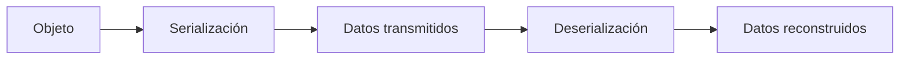

# Deserialización insegura

Serializar es transformar datos u objetos a una representación almacenable o transmisible. Deserializar es reconstruirlos. Algunas bibliotecas pueden ejecutar comportamiento durante esa reconstrucción, por lo que aceptar objetos no confiables puede provocar ejecución de código, manipulación de datos o denegación de servicio.



```python
# No usar con datos externos no confiables
objeto = pickle.loads(entrada)
```
```python
# Alternativa para datos simples: analizar y comprobar esquema
import json
objeto = json.loads(entrada)
if not isinstance(objeto, dict) or not isinstance(objeto.get("nombre"), str):
    raise ValueError("Formato inválido")
```
JSON no elimina otros riesgos: limitar tamaños, validar estructura y valores, comprobar autorización y evitar confiar en roles enviados por el cliente. XML requiere configuración segura (ver [[XML y XXE]]). No intentar proteger pickle no confiable validando el resultado después de cargarlo.

El apunte menciona SerialKiller, extensiones de Burp Suite y análisis estático (SAST). La deserialización insegura era A8:2017 y se integra en A08:2021, fallos de integridad del software y los datos.

Fuente: S7, pp. 24–29 y 33–34.
