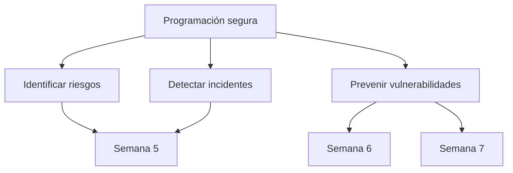

# Programación Segura · Unidad 2

Portafolio individual de estudio PRO203. La seguridad no consiste solo en escribir código que funcione, sino en proteger los datos y mantener el sistema confiable durante su operación.

> [!tip] Cómo estudiar
> Lee el resumen semanal, revisa los diagramas, explica los ejemplos con tus palabras y responde las preguntas sin mirar la solución.

| Ruta | Aprendizaje |
|---|---|
| [[Semana 05/Resumen semana 5]] | Riesgos, protección de activos y monitoreo |
| [[Semana 06/Resumen semana 6]] | Control de acceso, criptografía, inyección y XML |
| [[Semana 07/Resumen semana 7]] | Configuración, XSS y deserialización |
| [[Material complementario/Recursos]] | Videos y lectura de la unidad |
| [[Repaso general/Preguntas de estudio]] | Autoevaluación individual |
| [[Repaso general/Comparativa OWASP]] | Clasificaciones 2017 y 2021 |
| [[Repaso general/Glosario]] | Conceptos rápidos |

**Alcance:** semanas 5–7. Las clases anteriores solo se emplean como refuerzo pertinente. Los ejemplos son ficticios y educativos.
